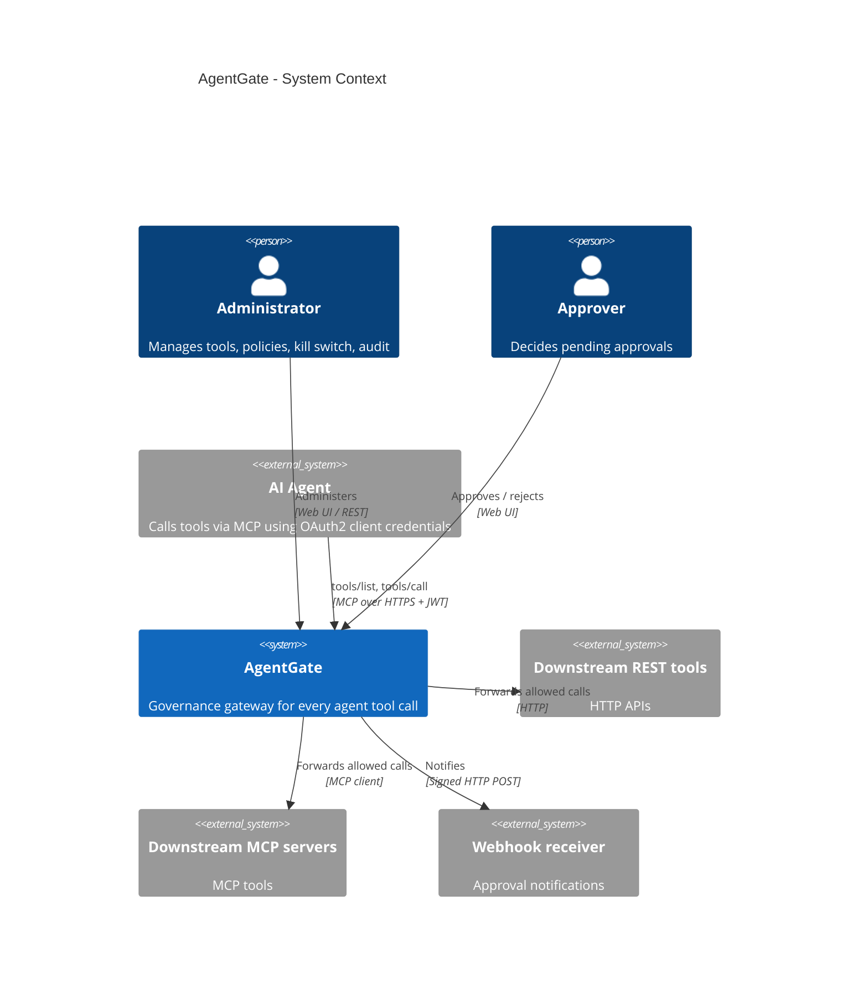
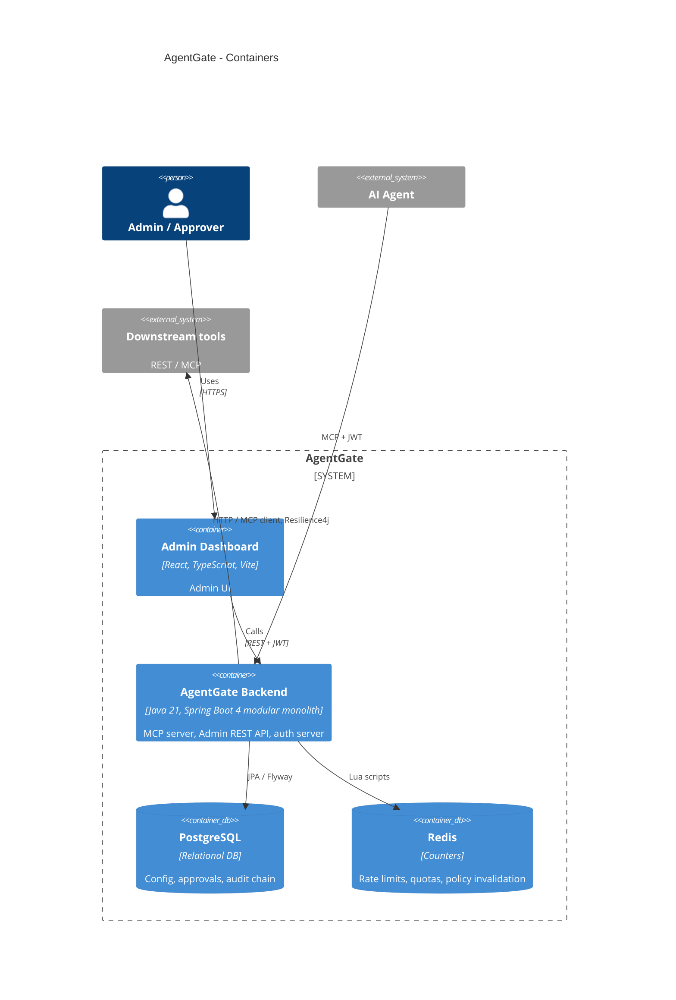
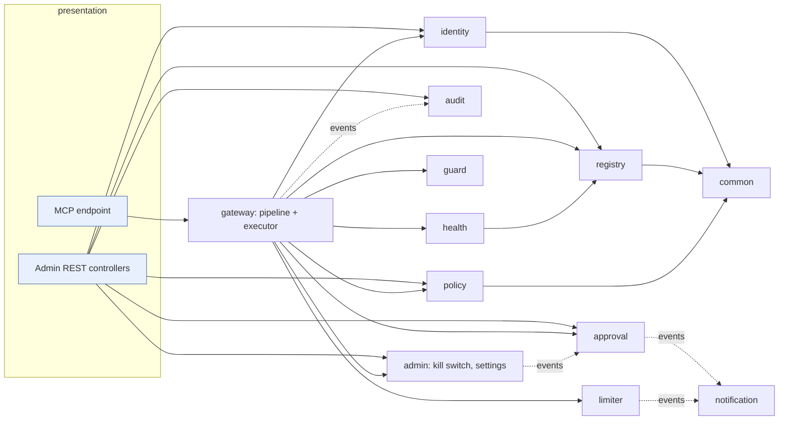
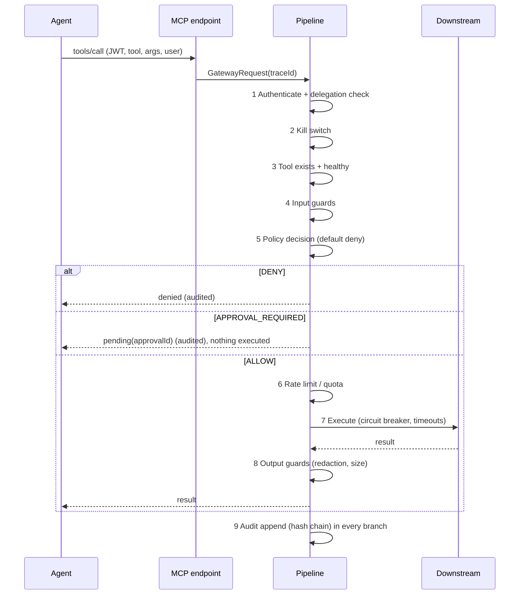

# C4 Architecture Diagrams (Mermaid, render on GitHub)

## Level 1: System Context

## Level 2: Containers

## Level 3: Components (backend modules)

Rule: arrows only point downward/rightward as above; `common` depends on nothing; cross-module calls go through an interface in the callee's `application` package; reverse notifications use Spring events (Observer).

## Level 3b: Gateway pipeline (Chain of Responsibility)

## Level 4 (code): see docs/design-patterns (Stage 18) and the ER diagram in docs/database.
