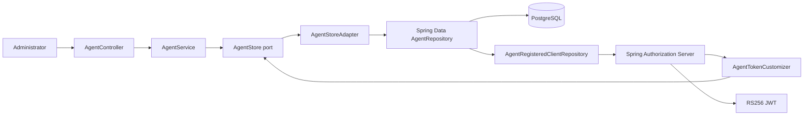
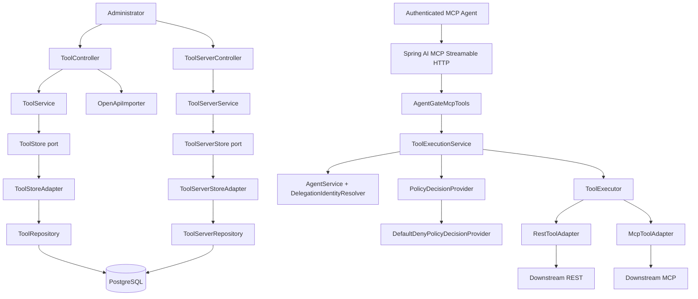

# C4 component diagrams — current Stage 4/5 implementation

## Identity module

## Registry and gateway modules

The default policy implementation returns DENY and hides every tool from agent discovery. This ensures the transport adapters cannot be reached until FR3 is implemented.
