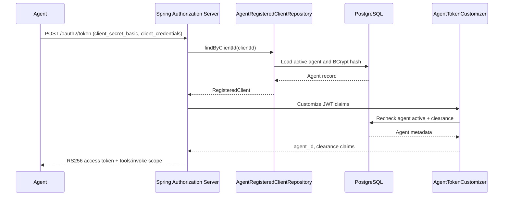

# Sequence diagrams — current Stage 4/5 implementation

## Agent client-credentials token issuance



## Agent MCP invocation (current fail-closed behavior)

```mermaid
sequenceDiagram
  participant Agent
  participant Security as Resource Server
  participant MCP as MCP Facade
  participant Exec as ToolExecutionService
  participant Identity as AgentService
  participant Policy as PolicyDecisionProvider
  Agent->>Security: MCP call with Bearer JWT
  Security->>Security: Validate signature, issuer, expiry, scope
  Security->>MCP: Authenticated request
  MCP->>Exec: invoke(agentClientId, toolName, arguments, delegation)
  Exec->>Identity: Recheck agent active
  Exec->>Exec: Verify optional HMAC delegation
  Exec->>Policy: Check discovery and policy decision
  Policy-->>Exec: DENY (bootstrap default)
  Exec-->>MCP: DENY + rule ID + explanation
  MCP-->>Agent: Tool call denied; no downstream request sent
```
