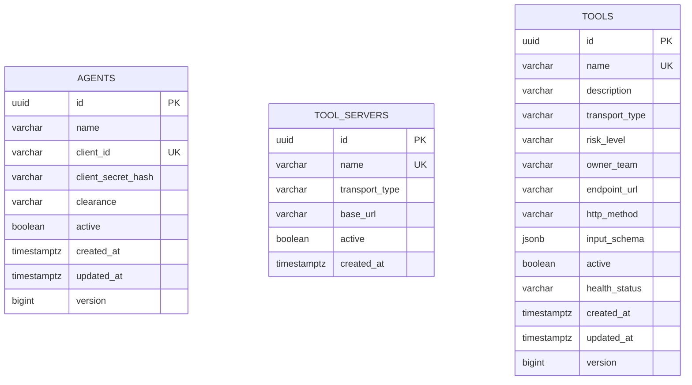

# Initial database schema

The first Flyway migration creates the identity and tool-registry tables. Later stages add policies, approvals, limits, audit records and kill-switch state.

`tool_servers` and `tools` are not yet joined by a foreign key. A tool currently stores the downstream endpoint directly; explicit server-to-tool association and connection credentials remain a later registry enhancement.
